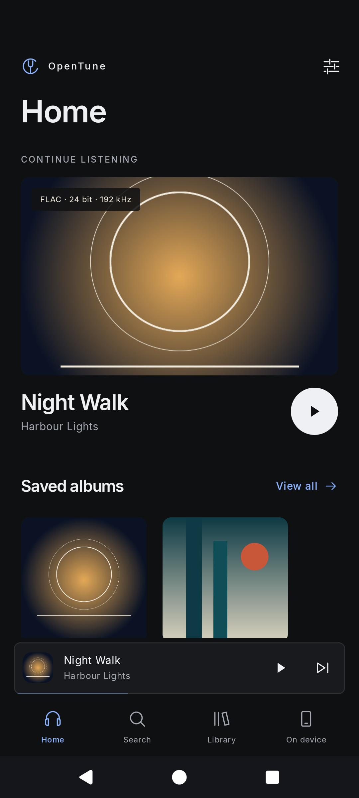
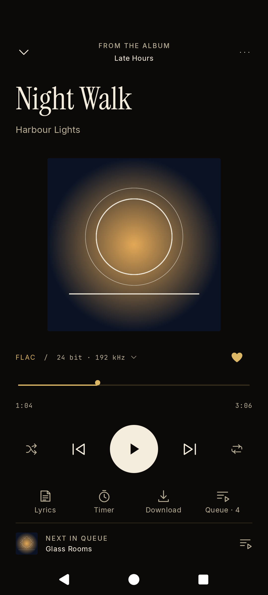
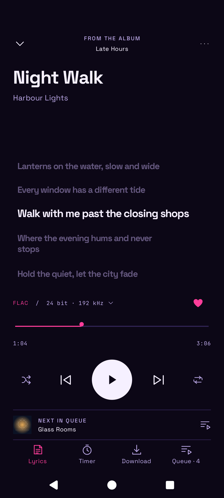
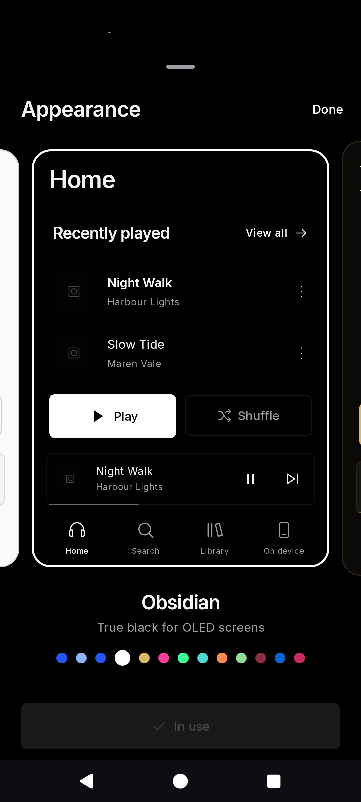

# OpenTune


An unofficial open source music player for TIDAL, with local playback.

Stream your TIDAL library in lossless quality, with synced lyrics, offline listening, Android Auto and twelve themes. Add your own audio files and folders, and they play alongside TIDAL in the same player. OpenTune has no ads, analytics or tracking, and artist identity corrections can optionally use MusicBrainz.

[](https://github.com/yyan115/tidal-app/actions/workflows/check.yml)
[](https://github.com/yyan115/tidal-app/releases)
[](LICENSE)

<p align="center">
  
  &nbsp;
  
  &nbsp;
  
  &nbsp;
  
</p>

## Install

Download the APK from the [newest release](https://github.com/yyan115/tidal-app/releases) and open it. Releases before 1.0.0 are marked as prereleases. If you installed the 1.0.0 build that was published briefly on 1 November 2026 and then withdrawn, uninstall it first, because Android does not install an older version over a newer one. OpenTune needs Android 8 or later. Android may ask you to allow installs from your browser or file manager.

To receive updates automatically, add `https://github.com/yyan115/tidal-app` to [Obtainium](https://obtainium.imranr.dev/) and turn on **Include prereleases**.

Releases are signed with one certificate. Compare it with the fingerprint below before you install, for example with [AppVerifier](https://github.com/soupslurpr/AppVerifier).

```text
SHA-256  4C:75:C0:15:05:B6:F2:A3:CF:88:57:6E:D4:A6:DA:93:AF:BD:13:D1:17:CF:7A:3A:C3:41:0C:AB:B9:66:B6:24
```

Each release also includes a `SHA256SUMS` file and a build provenance attestation. To check the attestation:

```sh
gh attestation verify opentune-<version>.apk --repo yyan115/tidal-app
```

## Features

**TIDAL**

- Lossless streaming up to 24-bit/192 kHz where TIDAL provides it. A lossless setting never falls back to AAC. The player shows the codec, bit depth and sample rate of the source.
- Home with your mixes, radio, new releases, genres and moods. Artist and album pages with biographies, reviews and credits. Music videos with picture-in-picture.
- Your library: saved tracks, albums, artists, playlists, folders and mixes. Create and edit playlists, organise them in folders and save playlists from other people.
- Lyrics that follow the song, track and artist radio, and autoplay that keeps the music going when the queue ends.
- Downloads as tagged audio files in `Music/OpenTune`, offline mode, and experimental options that download a track when you save it or when it plays.

**Your own music**

- Add audio files, or add a folder and OpenTune keeps it in sync. **On device** lists everything stored on the phone, from TIDAL downloads to your own files, which carry a **Local** mark.
- Local files show their format, bit depth, sample rate, bitrate and location, and take their cover from the file or its folder.
- Local music plays without an account. Playlists made on the device can hold local files and TIDAL tracks.

**Playback and system**

- Gapless playback with a deep buffer, a queue that you reorder by dragging, shuffle that reorders the queue itself, a sleep timer, volume normalization and a setting that avoids tracks that played recently, with a page that lists them.
- Experimental: a visualizer, an equalizer, ListenBrainz, bit-perfect USB output on Android 14 and later, and automatic downloads.
- Controls in the notification, on the lock screen, on Bluetooth devices and in Android Auto. A home screen widget and voice requests such as "play Nujabes".

**Your phone, your way**

- Twelve themes, each with its own colours, shapes and type, and a setting that follows the device. The picker previews every theme before you choose.
- Listening statistics, and backup and restore.
- Every piece of text is in a string resource, so translations can be added without changing code, see [docs/translating.md](docs/translating.md).

The [usage guide](docs/usage.md) explains each part.

## Privacy

OpenTune connects to TIDAL. It has no ads, analytics, crash reporting or server of its own. Artist identity correction is optional: when you use it, OpenTune sends the searched artist name and the selected MusicBrainz artist ID to MusicBrainz. Recording matching runs on the device; TIDAL credentials are not sent to MusicBrainz. The selected identity and matched catalogue are saved locally and can be reset. Scrobbling is also off by default. If you turn it on and add a token, OpenTune sends the artist, title and album of tracks you finish to the ListenBrainz server that you choose.

- You sign in on TIDAL's website in your browser. OpenTune never receives your password.
- Account tokens are stored encrypted with a key held in the Android Keystore.
- OpenTune requests no storage, location, contacts or microphone permissions. It reads only the files and folders that you pick with the system file picker.
- Android backup and device transfer exclude OpenTune data.

TIDAL still receives your account and streaming requests.

## Disclaimer

OpenTune is an independent project. It is not affiliated with, endorsed by or sponsored by TIDAL. TIDAL is a trademark of its owner.

Streaming requires a TIDAL subscription. OpenTune uses TIDAL's unofficial interfaces, so TIDAL can change or block them without notice. Protected streams are not supported. You are responsible for following TIDAL's terms of service.

## Build

You need JDK 21, Android SDK 36 and Android build tools 35.0.0. Set `ANDROID_HOME` or put the SDK path in an untracked `local.properties` file.

```sh
./gradlew :app:assembleDebug
```

The APK is written to `app/build/outputs/apk/debug/app-debug.apk`. Debug and release builds use different application IDs, so both can be installed together.

## Contributing

Read [CONTRIBUTING.md](CONTRIBUTING.md) before you open a pull request. Report security problems as described in [SECURITY.md](SECURITY.md). Maintainers can find the release process in [docs/releasing.md](docs/releasing.md).

## License

[Apache-2.0](LICENSE). Dependency licenses are listed in [THIRD_PARTY_NOTICES.md](THIRD_PARTY_NOTICES.md).

### Smart Shuffle

The player has a saved global Smart Shuffle switch (off by default). It works with albums, playlists, favorites, artist pages, search results and individual TIDAL tracks, independently of normal shuffle. After three started regular tracks it inserts one available track-radio recommendation after manually queued songs, then continues the original queue. Skips count; pause/resume and seeking do not. Recommendations do not count toward the interval. Queue tracks, the current playback collection already loaded into the queue and the last 50 tracks heard while enabled are excluded.

Turning it off removes waiting recommendations while letting the current song finish. Offline mode, local files, signing out and Repeat One suspend recommendations. Switching playback collections/accounts resets progress; late radio responses are discarded. Network failures skip one recommendation slot without interrupting playback. The global setting is included in local backups. The behavior is based on [Duffed’s Smart Shuffle plugin](https://github.com/Duffed/tidaluna-smart-shuffle); the Android implementation runs in the playback service.

## This fork

This working version targets [Duffed/tidal-app](https://github.com/Duffed/tidal-app). See [publishing the fork](docs/FORK_RELEASE.md) for test APKs and signed releases. The upstream project and license notices remain attributed above.
